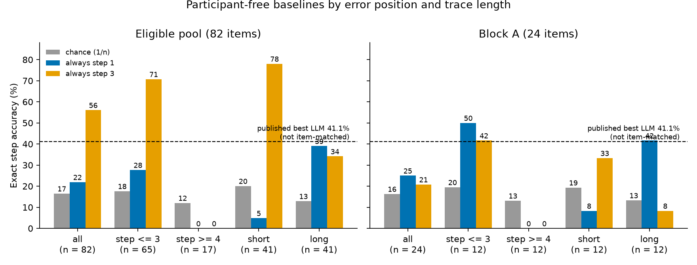
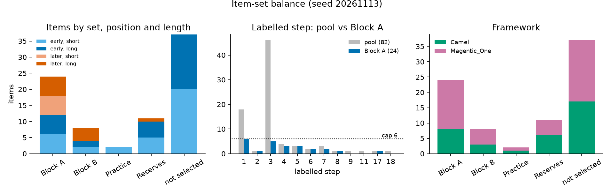
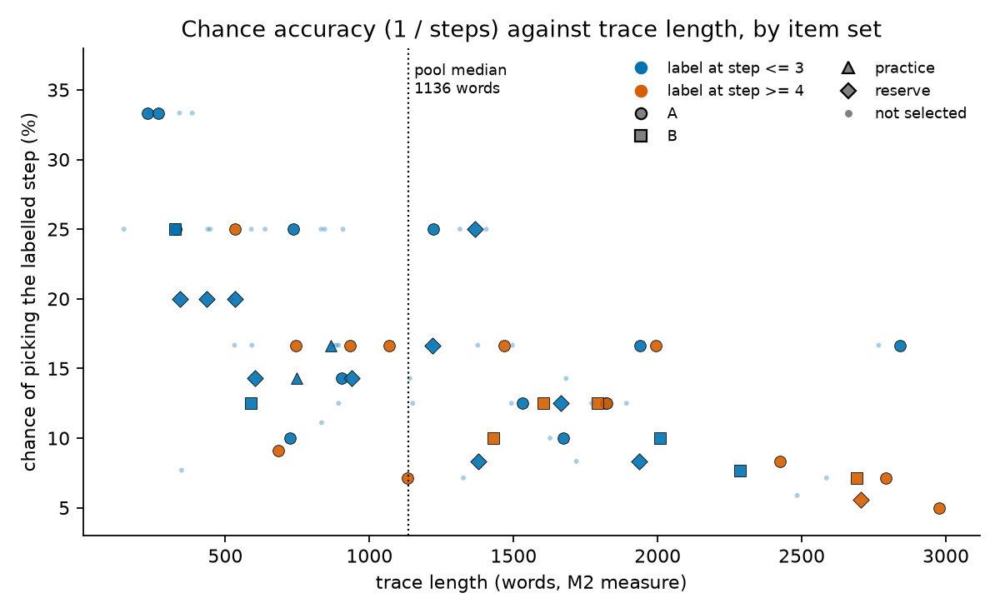

# Where did the AI agents go wrong? A study instrument for finding the first hallucinated step

**Two people labelling blind agreed only weakly on which step failed first (Cohen's kappa 0.261), so the "correct answer" in this task is itself contestable.**

| | |
|---|---|
| **Problem** | When a team of AI agents produces a wrong result, a developer reads long logs to find where it first went wrong. Nobody has measured whether a visual view helps people do that better than a plain log. |
| **Solution** | An offline web app showing the same trace as a console log or as a swimlane, a balanced item set from a public benchmark, shortcut checks and a blind label-validity check. |
| **Result** | **A "always answer step 3" shortcut scored 56.1% on the raw pool (chance 16.5%); balancing cut it to 20.8%.** The two screeners both differed from the published label by more than one step on 18 of 32 items. |
| **My role** | Co-authored research. I did most of the work; see [My role](#my-role). |



> **Status:** no participants have been recruited, because ethics review for a classmate study is unresolved. There is **no result about whether either view helps**, and nothing in `simulated/` is a finding.

## Problem and research question

Automated methods rarely find the first hallucinated step: the AgentHallu authors report 41.1% for the best of 13 models. A person is still the last check. The question: **do people find that step more accurately with a console log (View A) or with an information-equivalent swimlane view, one row per agent (View B)?** Answers are scored against the AgentHallu labels.

## Data

- **AgentHallu** (Liu et al., 2026), commit `9ffe8bc`: multi-agent traces with a labelled first hallucinated step. The repository states CC BY 4.0 and the paper states CC BY-NC-SA 4.0; the stricter terms are followed (see [`NOTICE`](NOTICE)). The dataset is not redistributed here.
- **Eligible pool:** 82 traces (47 Magentic-One, 35 Camel) with at most 20 steps and 3,000 words, a known responsible agent and one per question.
- **Selected items:** 34 (24 in the main block, 8 in a block with a suggested step, 2 practice), chosen with recorded seeds; 11 reserves.
- **Known issue:** 46 of the 82 pool labels sit at step 3.

## Method

1. Parse each trace into steps, keeping labels and the dataset's explanations out of the app.
2. Balance the main block over error position and trace length.
3. Build both views from the same text, and check equivalence with a self-test of 6,439 checks that was itself tested by deliberately changing one character.
4. Measure what simple rules score without any participant (baselines and ablations).
5. Both authors label the first hallucinated step blind, before opening the label file.
6. Fix the analysis plan (a mixed-effects logistic model) and test the code on simulated data only.

## Results

| Exact step accuracy | Pool (82) | Main block (24) |
|---|---|---|
| Chance | 16.5% | 16.3% |
| Always step 1 | 22.0% | 25.0% |
| Always step 3 | **56.1%** | **20.8%** |

| Blind screening (32 scored items) | Value |
|---|---|
| Agreement between screeners (Cohen's kappa) | 0.261 |
| Exact agreement (chance 0.154) | 0.375 |
| Agreement within one step | 0.594 |
| Both screeners more than one step from the published label | 18 of 32 |

| Item-set balance | Chance by trace length |
|---|---|
|  |  |

Sources: [`results/baselines.csv`](results/baselines.csv), [`results/screening/screening_agreement.md`](results/screening/screening_agreement.md), [paper](paper/paper.pdf).

## Key insights

- **Check position shortcuts before scoring anyone.** On the raw pool a fixed answer beat the best published model figure (not measured on the same items).
- **Balancing works for the set, not inside every group:** among the 12 early-position items, "always step 1" still scores 50%.
- **Report tolerant accuracy and a sensitivity analysis.** Low agreement does not show the labels are wrong, since screener error cannot be separated from label error, but it shows they are debatable.

## Limitations and next steps

- No participant data; one pilot session by a researcher is described in the paper without any statistical test.
- The screeners are the two authors, undergraduates reading about 1.5 to 2 minutes per item.
- Error position and category are confounded; only two agent frameworks and traces of 3 to 20 steps.
- Suggested-step errors are rule-based, not real model errors; no language-model baseline was run on these items.
- **Next:** resolve ethics review, run the study, and add an item-matched model baseline.

## Install and run

Python 3.11 or newer (developed on 3.15, Windows 11). The app needs no build step.

```powershell
git clone https://github.com/abdullahwaheed0112/hallucination-attribution-study.git
cd hallucination-attribution-study
python -m pip install numpy scipy pandas statsmodels matplotlib pypdf
python -m http.server 8765 --directory app
```

Open `http://localhost:8765`; `http://localhost:8765/selftest.html` must report `RESULT: PASS`. Rebuilding the item set needs the AgentHallu data. All commands, expected outputs and runtimes are in the [run guide](docs/run-guide.md).

## Project structure

```text
app/        offline study app (HTML, CSS, JavaScript, SVG)
src/        item selection, data export, representation ablation, screening agreement
scripts/    baselines, analysis, simulation, figures, checks, power planning
results/    outputs from real files, including both screening files
simulated/  SIMULATED outputs used to test the analysis code
figures/    figures from real and simulated files
paper/      LaTeX source, figures and compiled PDF
docs/       run guide, decision log, item-set and session notes
```

## Tech stack

Python (pandas, NumPy, SciPy, statsmodels, Matplotlib) · JavaScript, HTML, CSS, SVG · LaTeX

## My role

Co-authored research project. I (Abdullah Waheed) did most of the work, including the study app, the item-selection pipeline, the baselines, ablations and analysis code, and the paper. Chaudhary Abdul Moiz is co-author and was the second blind screener of the labels.

## Licences and credits

- Traces: AgentHallu (Liu, X., Yang, X., Li, Z., Li, P., & He, R., 2026), https://github.com/liuxuannan/AgentHallu. Files here that contain its trace text (`results/step_table.csv`, `app/data/items.js`) are under CC BY-NC-SA 4.0. See [`NOTICE`](NOTICE).
- Who&When (Zhang et al., 2025), MIT licence: not needed for the item set.
- No separate licence has been chosen for the code in this repository.

Contact: [github.com/abdullahwaheed0112](https://github.com/abdullahwaheed0112)
